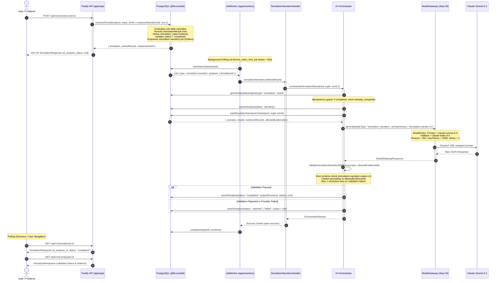

# Step 63: End-to-End AI Simulation Narration — Comprehensive Implementation Report

## 1. Executive Summary & Objective

In **Global Step 63** (Phase 9 Step 5), Fluxora implements production-quality, evidence-grounded AI simulation narration for its deterministic failure simulation engine.

This step extends the AI reasoning pipeline established across Steps 59–62:
$$\text{Deterministic simulation execution} \longrightarrow \text{Persisted simulation results \& evidence} \longrightarrow \text{Tenant-scoped narration context} \longrightarrow \text{Model Gateway} \longrightarrow \text{Strict structured-output validation} \longrightarrow \text{Durable AIAnalysis persistence} \longrightarrow \text{Authenticated API} \longrightarrow \text{AISimulationNarrationPanel UI}$$

The primary objective is providing engineering teams with narrative clarity regarding complex multi-hop failure propagation cascades without allowing the LLM to become a secondary source of truth. The deterministic simulation engine remains the sole authority for:
- Injected target failure types and parameters.
- Actual failure propagation paths and dependencies traversed.
- Resulting component states (`failed`, `degraded`, `at_risk`, `healthy`) and circuit-breaker `capped` flags.
- Traversal metrics (hop distances, node counts, rule evaluation cycles, and convergence).

A successful simulation run remains 100% available and valid even if AI narration fails, times out, or gets rejected.

---

## 2. Architecture & End-to-End Data Flow

---

## 3. Core Architectural Invariants

### 3.1 Deterministic Core vs. Probabilistic Narrator
- The deterministic simulation engine is authoritative. Hop counts, affected node lists, and resulting failure states are never inferred or recalculated by the LLM.
- The model prompt explicitly instructs: "Do not invent affected services, dependency paths, or failure propagation. Do not present speculation as verified fact. Distinguish simulated scenarios from real production observations."

### 3.2 AI Optionality & Isolation
- The failure of an AI narration job (due to provider downtime, token budget exhaustion, or schema rejection) never rolls back, invalidates, or retries a completed deterministic simulation.
- Rejection of an AI output marks the `ai_analyses` row as `rejected` with `output_text = null` and `output_structured = null` so that raw, invalid, or ungrounded model output is never exposed to users or API clients.

### 3.3 Strict Evidence Grounding & Manifest Synchronization
- Every claim emitted in `output_structured.claims` must include non-empty `evidence_ids`.
- Every cited ID must be present in `allowedEvidenceIds`. Fabricated IDs or IDs trimmed during context truncation cause immediate validation failure and trigger at most one bounded corrective retry.
- **Important Grounding Distinction**: Semantic support for a claim is **not** established by manifest membership alone. Manifest membership guarantees structural provenance (that an evidence record was created by `EvidenceWriter`, belongs to the authenticated organization/simulation run, and was retained in bounded context). The semantic truth of the model's textual claim is bounded by LLM reasoning over verified evidence.

---

## 4. Job Durability Failure Scenario Audit & Recovery Analysis

| Failure Scenario | Failure Window Description | Immediate System Impact | Production Recovery Path & Mechanism |
|---|---|---|---|
| **Scenario A** | Simulation execution begins, but transactional job INSERT fails (e.g., DB storage/pool error). | Transaction rolls back atomically. Simulation results and evidence are NOT persisted. Simulation marked `failed`. | **Atomic Transactional Rollback:** Because `executeSimulation` performs deterministic simulation persistence, evidence writes, and `simulation.narration` job insertion within the **exact same PostgreSQL transaction**, failure of the job insert rolls back all changes. No completed simulation is ever committed without its job in production. |
| **Scenario B** | Orphaned completed simulation exists (e.g., manual migration, external script with `enqueueNarrationJob: false`, or job deleted before AI analysis). | Deterministic simulation remains committed as `completed`, but lacks active job or `ai_analyses` record. | **Administrative Reconciliation Utilities:** `@fluxora/db` provides `reconcileSimulationNarrationJob` and `reconcileMissingSimulationNarrationJobs` using idempotent upserts (`ON CONFLICT (organization_id, idempotency_key) DO UPDATE SET id = jobs.id`). **Audit Note:** Because Fluxora does not currently operate an active background cron/scheduler daemon, these functions are operational utilities (ready for runbook/CLI invocation), not active background sweepers. |
| **Scenario C** | Job is inserted, but worker crashes before or during job processing. | Job remains in `jobs` table with `status = 'running'` and active lease. Worker process terminates. | **Lease Expiration & Reclaiming:** The job lease (`lease_expires_at = now() + 60s`) expires. Next call to `fluxora_claim_next_job` reclaims the job. `orchestrateSimulationNarration` checks `getAIAnalysisBySubject`: if completed before crash, returns `already_completed` without re-calling LLM; if not, completes execution. |
| **Scenario D** | Worker processes job, but AI provider (503/429/timeout) or validation rejects. | LLM fails or produces ungrounded output. Simulation is unaffected. | **Safe Failure Persistence & Isolation:** `orchestrateSimulationNarration` records `status = 'failed'` or `'rejected'` with withheld output (`output_structured = null`). Worker completes job without re-throwing. Deterministic simulation remains 100% authoritative and interactive. |

---

## 5. Model Configuration & Gateway Policy

The AI Simulation Narration pipeline uses the deterministic Model Gateway routing policy configured in `apps/workers/src/ai/policy.ts`:

- **Task Type**: `simulation_narration`
- **Primary Model**: `claude-sonnet-5-5` (`CANONICAL_PRIMARY_MODEL`)
- **Fallback Model**: `claude-haiku-5-5` (`CANONICAL_FALLBACK_MODEL`)
- **Timeout Budget**: `30,000ms` (30 seconds)
- **Max Generation Tokens**: `2048` tokens
- **Max Primary Retries**: `2` (within model routing gateway)
- **Validation Retry Ceiling**: At most `1` corrective retry (max 2 total response attempts across validator)
- **Structured Output Schema Version**: `simulation-narration-output-v1`
- **Prompt Template Version**: `simulation-narrate-v1`

---

## 6. Key Implementation Components

### 6.1 Shared Types (`packages/shared-types`)
- Extended `SimulationResponse` with optional `ai_analysis_id?: string | null` and `ai_analysis_status?: AIAnalysisStatus | null`.
- Added `SIMULATION_NARRATION_JOB_TYPE = "simulation.narration"`, `SimulationNarrationJobPayload` interface, `simulationNarrationIdempotencyKey(simId)` generator, and `parseSimulationNarrationJobPayload` parser.

### 6.2 Database Repositories, Transactional Outbox & Reconciliation (`packages/db`)
- `executeSimulation`: executes rule tables across dependency graph, atomically persisting `SimulationResult` records, `simulation_state` evidence via `EvidenceWriter.createSimulationStateEvidence`, updating simulation status to `'completed'`, and transactionally inserting the `simulation.narration` job within the exact same database transaction when `options.enqueueNarrationJob: true`. Any failure during job insertion rolls back all simulation state atomically.
- **Evidence Association Contract**:
  - `evidence.subject_type = 'simulation_state'`
  - `evidence.subject_id = simulation_result.id` (strictly links to the specific simulated node outcome in `simulation_results`, distinct from `simulation.id`)
  - `evidence.metadata.simulationId = simulation.id` (links to the parent `simulations` record for tenant-scoped querying)
  - `evidence.metadata.simulationResultId = simulation_result.id`
  - `evidence.metadata.nodeId = simulation_result.node_id`
- `listSimulationEvidence`: queries `evidence` rows where `subject_type = 'simulation_state'` and `metadata->>'simulationId' = simulationId` with strict tenant isolation and scenario ownership verification.
- **Operational Reconciliation Utilities**: `reconcileSimulationNarrationJob` and `reconcileMissingSimulationNarrationJobs` provide idempotent recovery (`ON CONFLICT (organization_id, idempotency_key) DO UPDATE SET id = jobs.id`) for orphaned completed simulations. As verified by audit, these are exported repository utilities ready for operational/runbook use, not active background cron sweepers (as Fluxora currently has no active cron scheduler daemon).
- **AIAnalysis Subject Contract, Idempotency & Unique Constraint**:
  - The `ai_analyses` table (Migration `0028_ai_analyses_storage.sql`) enforces polymorphic storage using `subject_type` and `subject_id`.
  - Supported `AIAnalysisSubjectType` enum values across schema (`0028_ai_analyses_storage.sql`), shared types (`packages/shared-types/src/ai.ts`), and repository validation (`packages/db/src/repositories/ai-analysis.ts`):
    - PR Impact Explanation (Step 62): `subject_type = 'impact_analysis'`, `subject_id = impact_analysis.id` (strictly links to the computed `impact_analyses` record, NOT `pull_request`).
    - Failure Simulation Narration (Step 63): `subject_type = 'simulation'`, `subject_id = simulation.id`.
    - Architecture Q&A Chat (Step 64): `subject_type = 'chat_query'`.
  - Database uniqueness: `UNIQUE (organization_id, subject_type, subject_id)` guarantees idempotent 1:1 analysis storage per subject within an organization.

### 6.3 Simulation Context Assembler (`apps/workers/src/ai/simulation-context`)
- `assembler.ts`: Pure, deterministic function sorting results with the canonical 4-key comparator:
  1. **Confidence descending** (`b.confidence - a.confidence`): higher-confidence outcomes receive priority even when a lower-confidence outcome has greater severity.
  2. **State severity descending** (`failed > degraded > at_risk > healthy`, with unknown states defaulting to `0`): resolves equal-confidence outcomes. (`capped` is tracked as a separate `boolean` flag on `BoundedSimulationNodeResult`, not a severity level.)
  3. **Hop distance ascending** (`a.hopDistance - b.hopDistance`): shorter hop distances resolve equal-confidence, equal-severity outcomes.
  4. **Stable `nodeId` ascending** (`a.nodeId.localeCompare(b.nodeId)`): deterministic lexicographical final tie-breaker.
  This ordering determines which results survive the `maxResults` and `maxTotalCharacters` context budgets. Maps `rec.subjectId` to `resultsById.get(rec.subjectId)` to associate evidence records directly with their corresponding `SimulationResult` rows, and strictly synchronizes `allowedEvidenceIds` with retained evidence records.
- `loader.ts`: Tenant-scoped loader enforcing `completed` simulation status and non-empty results before context assembly.
- `request-builder.ts`: Prompt builder employing `simulation-narrate-v1`, XML wrapping with Unicode sanitization (`\u003c`, `\u003e`, `\u0026`), and explicit anti-hallucination guardrails.

### 6.4 Structured Output Validator (`apps/workers/src/ai/structured-output`)
- `simulation-validator.ts`: Validates `SimulationNarrationOutput` (`summary`, `claims`, `confidence`, `caveats`), schema version `simulation-narration-output-v1`. Enforces whole-response atomic rejection and provides corrective instruction on validation failure.

### 6.5 Simulation Orchestrator (`apps/workers/src/ai/simulation-orchestrator.ts`)
- Implements `orchestrateSimulationNarration` with idempotency guards, redelivery checks, pending record creation, Model Gateway dispatch, corrective retry aggregation, and error sanitization.

### 6.6 Production Callsite & Worker Job Handler (`apps/workers/src/simulation`)
- `narration-handler.ts`: Implements `processSimulationNarrationJob` and `createSimulationNarrationHandler`, registered in `createDefaultJobHandlers()` under `SIMULATION_NARRATION_JOB_TYPE`.
- Connects worker execution directly to `orchestrateSimulationNarration` with tenant scope, OpenTelemetry tracing (`fluxora.worker.simulation_narration.process`), and failure isolation.

### 6.7 API Exposure & Job Handoff (`apps/api`)
- Extended `formatSimulationResponse` to format `ai_analysis_id` and `ai_analysis_status`.
- Updated `handleRunScenario`: invokes `executeSimulation(pool, orgId, simId, { enqueueNarrationJob: true })` which atomically enqueues the narration job inside the database transaction. The post-simulation `deps.enqueueJob` hook exists strictly as an isolated dependency-injection seam for in-memory unit tests (where `executeSimulation` is mocked without database access).
- Read-only `handleGetSimulation` queries `getAIAnalysisBySubject` safely without triggering narration generation.

### 6.8 Frontend UI (`apps/web`)
- `AISimulationNarrationPanel.tsx`: Component displaying AI narration badge, simulated scenario disclaimer, model confidence, summary, claims with `EvidenceCitationList`, caveats, and bounded discovery poller (up to 5 attempts, 2-second interval) with "Check again" retry button.
- `SimulationStudio.tsx`: Integrated `AISimulationNarrationPanel` below Deterministic Impact Summary inside React fragment.

---

## 7. Verification & Quality Gates

### 7.1 Historical Test Count Reconciliation
An independent audit established the exact workspace test counts across all five packages:

- **Root cause for "4 skipped"**: `apps/workers` has 4 skipped tests (`4 skipped`). Reporting this figure omitted the 5 skipped tests in `packages/db`, which together total `9 skipped`.
- **Root cause for "98 files, 1,416 passed"**: This reflected an intermediate run prior to adding the 14-test `simulation-validator.test.ts` suite (99 - 98 = 1 file, 1,430 - 1,416 = 14 tests).
- **Current Canonical Workspace Totals**:
  - `packages/infrastructure`: 1 test file, 7 passed, 0 skipped
  - `apps/web`: 18 test files, 320 passed, 0 skipped
  - `packages/db`: 24 test files, 399 passed, 5 skipped (404 total)
  - `apps/api`: 15 test files, 207 passed, 0 skipped
  - `apps/workers`: 41 test files, 501 passed, 4 skipped (505 total)
  - **Monorepo Total**: **99 test files passed, 1,434 tests passed, 9 skipped, 0 failed**.

### 7.2 Quality Gates Table

All six quality gates passed independently with zero errors:

| Quality Gate | Command | Result | Notes |
|---|---|---|---|
| Evidence AST Lint | `pnpm lint:evidence` | PASSED (0 errors) | Verified all graph/impact write paths invoke EvidenceWriter |
| Monorepo Typecheck | `pnpm typecheck` | PASSED (0 errors) | 7/7 workspace packages compiled cleanly with TypeScript |
| ESLint Quality | `pnpm lint` | PASSED (0 errors) | Zero errors, zero warnings across all workspace packages |
| Unit & Integration Tests | `pnpm test` | PASSED (99/99 files) | 1,434 passed, 9 skipped across entire monorepo |
| Production Build | `pnpm build` | PASSED | Next.js 16 production build succeeded with Turbopack |
| Git Whitespace Check | `git diff --check` | PASSED | Clean working tree with zero whitespace violations |
