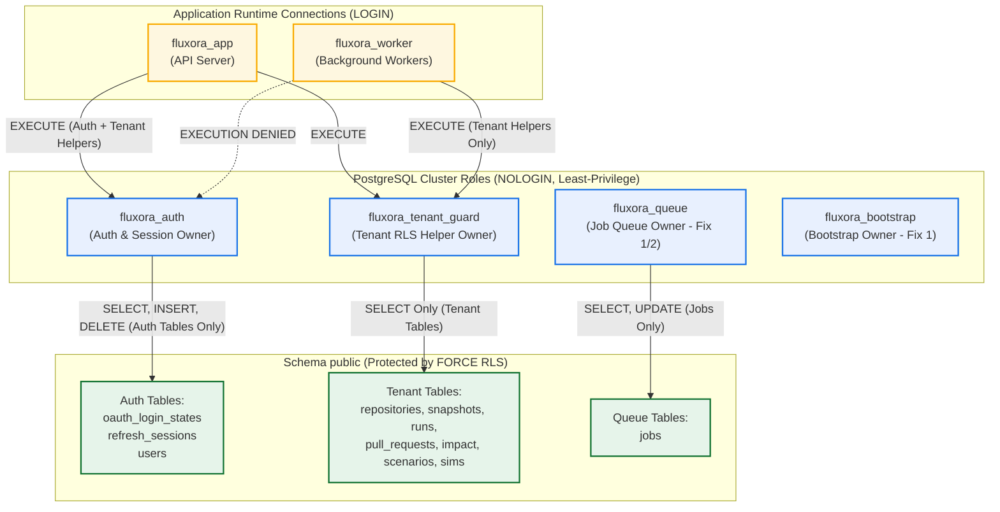

# Fluxora Production Hardening — Fix 3: PostgreSQL SECURITY DEFINER Security Hardening

## 1. Executive Summary & Problem Context

In PostgreSQL, functions configured with `SECURITY DEFINER` execute with the privileges and identity of the role that owns them, rather than the calling client role (`SECURITY INVOKER`). In a multi-tenant digital twin platform like Fluxora, `SECURITY DEFINER` is indispensable: it allows low-privilege application services and background workers to perform strictly controlled, security-sensitive operations—such as minting OAuth state verifiers, rotating refresh token families, and evaluating cross-tenant authorization boundaries—without giving the calling connections broad table-level `SELECT`, `UPDATE`, or `DELETE` grants.

However, `SECURITY DEFINER` functions represent one of the most perilous privilege-elevation mechanisms in relational databases if configured without rigorous defensive controls:
1. **Search-Path Shadowing (CVE-2018-1058)**: If `search_path` is not explicitly pinned to trusted schemas with `pg_temp` placed last, an untrusted caller can define temporary objects in `pg_temp` (such as a rogue table, view, or custom operator) that shadow system objects, hijacking execution under the function owner's elevated authority.
2. **Superuser / Migrator Ownership Anti-Pattern**: If sensitive functions default to being owned by the database migration runner or cluster superuser, any calling connection authorized to execute the function inherits superuser or administrative privileges during function evaluation.
3. **Overly Permissive Execution Grants (`PUBLIC`)**: In PostgreSQL, functions created without an explicit revocation default to granting `EXECUTE` privilege to the pseudo-role `PUBLIC`. This allows any connected database identity (including read-only or untrusted test roles) to execute the function.
4. **Row-Level Security (RLS) Interplay**: As proven in Fluxora Fix 1, `SECURITY DEFINER` does **not** bypass Row-Level Security for non-superuser owners when tables enforce `FORCE ROW LEVEL SECURITY`. Therefore, dedicated, least-privilege service roles must own the functions and possess explicit, scoped RLS policies.
5. **PostgreSQL 16+ `CREATEROLE` Privilege Escalation Trap**: In PostgreSQL 16 and later, when a non-superuser role possessing `CREATEROLE` creates another role, PostgreSQL automatically grants `ADMIN OPTION` on the created role to the creator with `INHERIT FALSE` and `SET FALSE`. A non-superuser creator cannot revoke `ADMIN OPTION` from itself, creating an indelible privilege escalation vector where a migration runner could administer cluster service roles.

### Scope of Fix 3 (Fix 3A, Fix 3B, Fix 3C)
Fix 3 eliminates these architectural vulnerabilities across the entire Fluxora platform:
- **Fix 3A (Core Schema Hardening)**: Audited all 20 `SECURITY DEFINER` functions across migrations `0001` through `0024`. Designed forward-only migration [`0025_security_definer_hardening.sql`](../../../packages/db/migrations/0025_security_definer_hardening.sql). Provisioned dedicated least-privilege `NOLOGIN` service roles: `fluxora_auth` (auth and session management) and `fluxora_tenant_guard` (tenant RLS helpers). Recreated all 12 unhardened functions with `SET search_path = pg_catalog, public, pg_temp`, fully schema-qualified relation references, revoked `PUBLIC` execute grants, revoked `CREATE ON SCHEMA public FROM PUBLIC`, and established dedicated RLS policies under `FORCE ROW LEVEL SECURITY`.
- **Fix 3B (Test Isolation & Cluster Role Safety)**: Eliminated destructive role drops at test startup. Introduced unique per-execution role suffixes (`fluxora_mig_<suffix>`, `fluxora_unauth_<suffix>`), positive tracking of test-created roles, complete pre-existing role snapshots (passwords, boolean attributes, connection limits), zero mutation of existing cluster roles (`fluxora_app`, `fluxora_worker`, `fluxora_rls_test`), and verified that all 19 directly callable `SECURITY DEFINER` functions reject unauthorized invocation with `permission denied`.
- **Fix 3C (Concurrency, Advisory Locking, Schema Privileges & Driver-Level Parser Safety)**: Solved cross-execution concurrency races by recognizing that PostgreSQL advisory locks are **database-local, not cluster-global**. Mandated an explicit, stable canonical lock database (`FLUXORA_CLUSTER_LOCK_DATABASE_URL`) with preflight endpoint consistency validation. Replaced naive URL string parsing with `pg-connection-string` resolution from the installed `pg` dependency, assembled frozen, branded `ValidatedPostgresConfig` objects, and proved that a constrained migration role possesses exact required schema privileges without superuser or `BYPASSRLS`. Documented in [`packages/db/src/migrate/security-definer-hardening.test.ts`](../../../packages/db/src/migrate/security-definer-hardening.test.ts) and [`docs/DESIGN.md`](../../../docs/DESIGN.md).

**Related Learning Documentation**:
- Technical Learning Notes: [`learning/notes/Fix-03-PostgreSQL-Security-Definer-Hardening.md`](../../notes/Fix-03-PostgreSQL-Security-Definer-Hardening.md)
- Staff Interview Cheat Sheet: [`learning/interviews/Fix 3 PostgreSQL SECURITY DEFINER Hardening Interview CheatSheet.md`](../../interviews/Fix%203%20PostgreSQL%20SECURITY%20DEFINER%20Hardening%20Interview%20CheatSheet.md)

### Current Verification Status & Local Limitations

> [!IMPORTANT]
> **Status:** Implementation and non-destructive verification completed; live destructive PostgreSQL integration verification pending.

All static SQL assertions, role comparator mechanics, driver-level connection string validation suites, and mock concurrency checks pass completely locally (32 passed, 5 skipped in the Fix 3 suite).

The following configuration variables are not set in the local development environment:
- `FLUXORA_QUEUE_TEST_DATABASE_URL` is not configured locally.
- `QUEUE_TEST_DATABASE_URL` is not configured locally.
- `FLUXORA_CLUSTER_LOCK_DATABASE_URL` is not configured locally.
- `FLUXORA_ALLOW_DESTRUCTIVE_QUEUE_MIGRATION_TESTS=true` is not configured locally.

Consequently, **live integration verification remains pending**. Verification must use a dedicated disposable PostgreSQL test database and a separate canonical advisory-lock database. Both databases must target the same PostgreSQL server, with validated host and port consistency. **`fluxora_dev` must never be used for destructive tests.** No credentials or database URLs are exposed in tests or logs. Exactly five live integration tests in the Fix 3 suite remain unverified locally until executed against a dedicated disposable PostgreSQL test cluster.

---

## 2. Threat Model & Review Findings

During the Fix 3 security reviews, the entire migration history (`0001` through `0024`) and PostgreSQL runtime interactions were audited against known threat vectors:

```
+-----------------------------------------------------------------------------------------------------------------------+
|                                              FIX 3 THREAT MODEL & MITIGATIONS                                          |
+------------------------------------+--------------------------------------+-------------------------------------------+
| Threat / Attack Vector             | Root Cause in Historical Migrations  | Production Hardening Resolution           |
+------------------------------------+--------------------------------------+-------------------------------------------+
| 1. Search-Path Hijacking           | Functions in 0002/0014/0017/0018/0019| Pin `search_path = pg_catalog, public,    |
|    (CVE-2018-1058)                 | lacked explicit trailing `pg_temp`   | pg_temp` and qualify all relations as     |
|                                    | and used unqualified table names     | `public.<table>`.                         |
+------------------------------------+--------------------------------------+-------------------------------------------+
| 2. Rogue Schema Object Creation    | `CREATE` on schema `public` was      | `REVOKE CREATE ON SCHEMA public           |
|    in Shared Public Schema         | granted to pseudo-role `PUBLIC`      | FROM PUBLIC;` in migration 0025.          |
+------------------------------------+--------------------------------------+-------------------------------------------+
| 3. Superuser / Migrator Execution  | Historical functions defaulted to    | Transfer ownership to dedicated `NOLOGIN`  |
|    Privilege Elevation             | ownership by migration executor      | service roles `fluxora_auth` and          |
|                                    | (superuser or admin role)            | `fluxora_tenant_guard`.                   |
+------------------------------------+--------------------------------------+-------------------------------------------+
| 4. Unauthorized Function Execution | Default or explicit `GRANT EXECUTE   | `REVOKE ALL ... FROM PUBLIC;` and grant   |
|    by Arbitrary Connections        | ON FUNCTION ... TO PUBLIC`           | strictly to `fluxora_app` / `worker`.     |
+------------------------------------+--------------------------------------+-------------------------------------------+
| 5. PostgreSQL 16+ Role             | Non-superuser creators with          | Service roles pre-provisioned by admin;   |
|    Administration Hijacking        | `CREATEROLE` receive indelible       | migrator receives temporary non-inheriting|
|                                    | `ADMIN OPTION` on created roles      | membership (`ADMIN FALSE`) for transfer.  |
+------------------------------------+--------------------------------------+-------------------------------------------+
| 6. Cluster Role Test Collisions    | Tests used static role names and     | Dynamic per-run suffixes, positive        |
|    and Accidental Role Mutation    | dropped roles at test startup;       | tracking, zero mutation of pre-existing   |
|                                    | mutated cluster role passwords       | roles, and password preservation checks.  |
+------------------------------------+--------------------------------------+-------------------------------------------+
| 7. False Advisory Lock Concurrency | Tests assumed `pg_advisory_lock`     | Dedicated canonical lock database         |
|    Isolation                       | was cluster-global; connections on   | (`FLUXORA_CLUSTER_LOCK_DATABASE_URL`) with|
|                                    | different test DBs did not serialize | preflight server endpoint matching.       |
+------------------------------------+--------------------------------------+-------------------------------------------+
| 8. Driver Connection Parsing       | Generic JS `URL` parser ignored      | Resolve `pg-connection-string` from `pg`, |
|    Divergence                      | query parameter overrides (`?host=`, | validate effective parsed config, and     |
|                                    | `?port=`) and encoded paths (`%5F`)  | construct frozen `pg.ClientConfig` objects|
+------------------------------------+--------------------------------------+-------------------------------------------+
```

### Complete Inventory of All 20 `SECURITY DEFINER` Functions

Across the 24 historical migrations in `@fluxora/db`, exactly 20 `SECURITY DEFINER` functions were identified:

| # | Function Signature | Source Migration | Pre-0025 Owner | Pinned search_path | Schema-Qualified | PUBLIC EXECUTE | Access Scope | Status in Fix 3 |
|---|---|---|---|---|---|---|---|---|
| 1 | `fluxora_create_organization(text, public.plan_tier, bigint)` | `0001` / `0007` | `fluxora_bootstrap` | `pg_catalog, public, pg_temp` | Yes (`public.*`) | Revoked | `organizations`, `subscriptions` | Pre-Hardened (Fix 1) |
| 2 | `fluxora_create_user(uuid, text, public.user_role, bigint)` | `0001` / `0003` | `fluxora_bootstrap` | `pg_catalog, public, pg_temp` | Yes (`public.*`) | Revoked | `users`, `memberships` | Pre-Hardened (Fix 1) |
| 3 | `fluxora_provision_github_user(bigint, text, text)` | `0003` | `fluxora_bootstrap` | `pg_catalog, public, pg_temp` | Yes (`public.*`) | Revoked | `users`, `github_user_mappings` | Pre-Hardened (Fix 1) |
| 4 | `fluxora_claim_next_job(text, integer)` | `0005` / `0024` | `fluxora_queue` | `pg_catalog, public, pg_temp` | Yes (`public.*`) | Revoked | `jobs` | Pre-Hardened (Fix 2) |
| 5 | `fluxora_complete_job(uuid, text)` | `0005` / `0024` | `fluxora_queue` | `pg_catalog, public, pg_temp` | Yes (`public.*`) | Revoked | `jobs` | Pre-Hardened (Fix 2) |
| 6 | `fluxora_fail_job(uuid, text, text)` | `0005` / `0024` | `fluxora_queue` | `pg_catalog, public, pg_temp` | Yes (`public.*`) | Revoked | `jobs` | Pre-Hardened (Fix 2) |
| 7 | `fluxora_retry_failed_job(uuid, text, integer, text)` | `0005` / `0024` | `fluxora_queue` | `pg_catalog, public, pg_temp` | Yes (`public.*`) | Revoked | `jobs` | Pre-Hardened (Fix 2) |
| 8 | `fluxora_jobs_retry_limits_guard()` | `0024` | `fluxora_queue` | `pg_catalog, public, pg_temp` | Yes (`public.*`) | Revoked | `jobs` (trigger) | Pre-Hardened (Fix 2) |
| 9 | `fluxora_store_oauth_login_state(text, text, timestamptz)` | `0002` | Migrator / Superuser | `pg_catalog, public` (no `pg_temp`) | No | Explicitly Granted | `oauth_login_states` | **Hardened in Fix 3** |
| 10 | `fluxora_consume_oauth_login_state(text)` | `0002` | Migrator / Superuser | `pg_catalog, public` (no `pg_temp`) | No | Explicitly Granted | `oauth_login_states` | **Hardened in Fix 3** |
| 11 | `fluxora_insert_refresh_session(uuid, uuid, uuid, text, timestamptz)` | `0002` | Migrator / Superuser | `pg_catalog, public` (no `pg_temp`) | No | Explicitly Granted | `refresh_sessions`, `users` | **Hardened in Fix 3** |
| 12 | `fluxora_rotate_refresh_session(text, text, timestamptz)` | `0002` | Migrator / Superuser | `pg_catalog, public` (no `pg_temp`) | No | Explicitly Granted | `refresh_sessions` | **Hardened in Fix 3** |
| 13 | `fluxora_revoke_refresh_family(text)` | `0002` | Migrator / Superuser | `pg_catalog, public` (no `pg_temp`) | No | Explicitly Granted | `refresh_sessions` | **Hardened in Fix 3** |
| 14 | `fluxora_revoke_user_refresh_sessions(uuid)` | `0002` | Migrator / Superuser | `pg_catalog, public` (no `pg_temp`) | No | Explicitly Granted | `refresh_sessions` | **Hardened in Fix 3** |
| 15 | `fluxora_snapshot_in_current_tenant(uuid)` | `0014` | Migrator / Superuser | `pg_catalog, public` (no `pg_temp`) | Partial | Explicitly Granted | `snapshots`, `repositories` | **Hardened in Fix 3** |
| 16 | `fluxora_analysis_run_in_current_tenant(uuid)` | `0014` | Migrator / Superuser | `pg_catalog, public` (no `pg_temp`) | Partial | Explicitly Granted | `analysis_runs`, `repositories` | **Hardened in Fix 3** |
| 17 | `fluxora_pull_request_in_current_tenant(uuid)` | `0017` | Migrator / Superuser | `pg_catalog, public` (no `pg_temp`) | Partial | Explicitly Granted | `pull_requests`, `repositories` | **Hardened in Fix 3** |
| 18 | `fluxora_impact_analysis_in_current_tenant(uuid)` | `0018` | Migrator / Superuser | `pg_catalog, public` (no `pg_temp`) | Partial | Explicitly Granted | `impact_analyses`, `repositories`| **Hardened in Fix 3** |
| 19 | `fluxora_scenario_in_current_tenant(uuid)` | `0019` | Migrator / Superuser | `pg_catalog, public` (no `pg_temp`) | Partial | Explicitly Granted | `scenarios`, `repositories` | **Hardened in Fix 3** |
| 20 | `fluxora_simulation_in_current_tenant(uuid)` | `0019` | Migrator / Superuser | `pg_catalog, public` (no `pg_temp`) | Partial | Explicitly Granted | `simulations`, `repositories` | **Hardened in Fix 3** |

---

## 3. SECURITY DEFINER Architecture & Role Governance

To uphold the principle of least privilege, Fluxora decouples execution authority across dedicated PostgreSQL service roles.



### 3.1 Role Responsibilities and Boundaries

#### `fluxora_auth`
- **Ownership Scope**: Owns the 6 authentication and session management functions (`fluxora_store_oauth_login_state`, `fluxora_consume_oauth_login_state`, `fluxora_insert_refresh_session`, `fluxora_rotate_refresh_session`, `fluxora_revoke_refresh_family`, `fluxora_revoke_user_refresh_sessions`).
- **Table Permissions**:
  - `public.oauth_login_states`: `SELECT, INSERT, DELETE`
  - `public.refresh_sessions`: `SELECT, INSERT, UPDATE`
  - `public.users`: `SELECT`
- **RLS Access**: Scoped permissive policies `oauth_login_states_auth_all`, `refresh_sessions_auth_all`, `users_auth_select` (`FOR ALL/SELECT TO fluxora_auth USING (true)`).
- **Security Boundary**: Zero access to repositories, snapshots, analysis runs, PR diffs, or graph tables.

#### `fluxora_tenant_guard`
- **Ownership Scope**: Owns the 6 cross-table tenant validation helper functions (`fluxora_snapshot_in_current_tenant`, `fluxora_analysis_run_in_current_tenant`, `fluxora_pull_request_in_current_tenant`, `fluxora_impact_analysis_in_current_tenant`, `fluxora_scenario_in_current_tenant`, `fluxora_simulation_in_current_tenant`).
- **Table Permissions**: Read-only `SELECT` strictly on parent tenant relationship tables (`repositories`, `repository_snapshots`, `analysis_runs`, `pull_requests`, `impact_analyses`, `scenarios`, `simulations`). Execution grant on `public.fluxora_current_org_id()`.
- **RLS Access**: Scoped permissive policies `*_tenant_guard_select` (`FOR SELECT TO fluxora_tenant_guard USING (true)`).
- **Security Boundary**: Zero write (`INSERT, UPDATE, DELETE`) access to any table. Zero access to auth tables (`refresh_sessions`, `oauth_login_states`).

### 3.2 Function Ownership vs. Table Ownership

A widespread misconception in PostgreSQL engineering is treating function ownership and table ownership as interchangeable. They enforce entirely different privilege boundaries:
- **Table Ownership (`relowner`)**: Governs the ability to alter table structures, drop tables, manage triggers, and **define Row-Level Security policies**. Table owners bypass RLS by default unless `FORCE ROW LEVEL SECURITY` is applied.
- **Function Ownership (`proowner`)**: When marked `SECURITY DEFINER`, the function executes with the privileges of its owner. However, **holding function ownership does NOT confer table ownership**.
- If `fluxora_auth` owned the `refresh_sessions` table, an administrator or developer acting as `fluxora_auth` could alter table columns, drop constraints, or disable RLS. By leaving table ownership with the migration identity (`fluxora_migrator`) and assigning only minimal `SELECT, INSERT, UPDATE` table grants to `fluxora_auth`, the function owner cannot alter the table schema or dismantle RLS safeguards.

---

## 4. Safe SECURITY DEFINER Function Configuration

To prevent search-path injection and object shadowing, every function hardened in Migration 0025 enforces four defensive layers:

```sql
CREATE OR REPLACE FUNCTION public.fluxora_store_oauth_login_state(
  p_state_hash text,
  p_code_verifier text,
  p_expires_at timestamptz
)
RETURNS void
LANGUAGE plpgsql
SECURITY DEFINER
SET search_path = pg_catalog, public, pg_temp
AS $$
BEGIN
  -- 1. Strict input validation
  IF p_state_hash IS NULL OR p_state_hash !~ '^[0-9a-f]{64}$' THEN
    RAISE EXCEPTION 'oauth state hash is invalid';
  END IF;

  IF p_expires_at IS NULL OR p_expires_at <= pg_catalog.now() THEN
    RAISE EXCEPTION 'oauth state expiry must be in the future';
  END IF;

  IF p_code_verifier IS NULL
     OR pg_catalog.char_length(p_code_verifier) < 43
     OR pg_catalog.char_length(p_code_verifier) > 128 THEN
    RAISE EXCEPTION 'oauth code verifier length is invalid';
  END IF;

  -- 2. Fully schema-qualified relation references and system calls
  DELETE FROM public.oauth_login_states
  WHERE expires_at <= pg_catalog.now();

  INSERT INTO public.oauth_login_states (state_hash, code_verifier, expires_at)
  VALUES (p_state_hash, p_code_verifier, p_expires_at);
END;
$$;
```

### Why Each Measure Matters:
1. **`SECURITY DEFINER`**: Elevates the execution context to the function owner (`fluxora_auth`), allowing callers lacking direct table grants to execute the operation.
2. **`SET search_path = pg_catalog, public, pg_temp`**:
   - `pg_catalog` first: Ensures core system functions (`now()`, `char_length()`, `coalesce()`) and operators resolve to trusted built-in system catalogs rather than user-defined shadow functions.
   - `pg_temp` explicitly last: Under PostgreSQL, if `pg_temp` is omitted from `search_path`, PostgreSQL automatically searches temporary schemas *first* for relation lookup. Placing `pg_temp` at the very end ensures permanent schema objects (`public.oauth_login_states`) are resolved before any session-local temporary tables.
3. **Explicit Schema Qualification (`public.<table>`)**: Hardens the query against ambiguity. Even if an attacker manipulates the search path, the parser resolves directly to the `public` schema.
4. **Revocation of `PUBLIC` Execution**:
   ```sql
   REVOKE ALL ON FUNCTION public.fluxora_store_oauth_login_state(text, text, timestamptz) FROM PUBLIC;
   GRANT EXECUTE ON FUNCTION public.fluxora_store_oauth_login_state(text, text, timestamptz) TO fluxora_app;
   ```
   Prevents unauthenticated database callers from executing the routine. Only the API server role (`fluxora_app`) is authorized.

---

## 5. PostgreSQL Role Membership Semantics & PG16+ Considerations

Role membership in PostgreSQL is frequently misunderstood. A role granted membership in another role does **not** automatically possess all powers of that role in every context.

### 5.1 Membership Options (`ADMIN`, `INHERIT`, `SET`)

PostgreSQL 16 restructured role membership management, introducing three orthogonal boolean options in `pg_auth_members`:

```sql
GRANT target_role TO member_role WITH ADMIN TRUE, INHERIT FALSE, SET TRUE;
```

1. **`ADMIN OPTION`**: Authorizes `member_role` to grant or revoke membership in `target_role` to other roles. **A role holding `ADMIN OPTION` presents a severe privilege escalation risk.**
2. **`INHERIT OPTION`**: Controls whether `member_role` automatically inherits privileges granted to `target_role` during standard query execution without executing `SET ROLE`.
3. **`SET OPTION`**: Controls whether `member_role` can execute `SET ROLE target_role` to explicitly assume the identity and privileges of `target_role`.

### 5.2 The PostgreSQL 16+ `CREATEROLE` Trap

In PostgreSQL versions prior to 16, a role with `CREATEROLE` could alter almost any non-superuser role. In PostgreSQL 16, this was hardened: a creator only receives privileges over roles it explicitly created.
However, this introduced a critical side-effect:
> **The `CREATEROLE` Automatic Admin Trap:** When a non-superuser role creates a role in PostgreSQL 16+, PostgreSQL automatically inserts a row into `pg_auth_members` granting the creator `ADMIN OPTION` on the new role with `INHERIT FALSE, SET FALSE`. Furthermore, a non-superuser **cannot revoke `ADMIN OPTION` from itself**.

If migration scripts run under a non-superuser `CREATEROLE` identity and dynamically execute `CREATE ROLE fluxora_auth`, the migration runner permanently retains `ADMIN OPTION` on `fluxora_auth`. Any future compromise of the migration identity allows an attacker to grant `fluxora_auth` to arbitrary users!

### 5.3 The Fix 3 Resolution: Pre-Provisioned Service Roles
1. Privileged service roles (`fluxora_auth` and `fluxora_tenant_guard`) **must be pre-provisioned by a trusted cluster administrator** (`postgres` superuser).
2. During migration, the administrator grants the migration identity temporary membership with:
   ```sql
   GRANT fluxora_auth, fluxora_tenant_guard TO fluxora_migrator WITH SET TRUE, INHERIT FALSE, ADMIN FALSE;
   ```
3. This allows `fluxora_migrator` to execute `ALTER FUNCTION ... OWNER TO fluxora_auth` (which requires `SET TRUE` membership), while strictly denying `ADMIN OPTION` (`ADMIN FALSE`) and denying automatic privilege inheritance (`INHERIT FALSE`).
4. After migration, the administrator explicitly revokes the membership.

### 5.4 Membership Snapshot Restoration Architecture
To verify test safety across PostgreSQL versions, the test suite captures and restores complete membership metadata:
- In PostgreSQL 16+: Queries `admin_option`, `inherit_option`, and `set_option` directly from `pg_catalog.pg_auth_members`.
- In PostgreSQL < 16: Queries only `admin_option`, recording `null` for `inherit_option` and `set_option` to avoid referencing non-existent catalog columns.
- The snapshot comparator `sortMembershipSnapshots()` verifies that no options were altered or added during test execution.

---

## 6. Migration 0025 & Deployment Prerequisites

Migration `0025_security_definer_hardening.sql` is a forward-only DDL script that modifies function configurations and schema ACLs.

### 6.1 Schema Ownership vs. Database CREATE Privileges

A key discovery in Fix 3C was understanding why `ALTER SCHEMA public OWNER TO fluxora_migrator;` is necessary and what privileges it requires:

1. **Why Ordinary `REVOKE ... FROM PUBLIC` Requires Schema Ownership**:
   - `REVOKE CREATE ON SCHEMA public FROM PUBLIC;` modifies the access control list on the existing schema.
   - Under PostgreSQL privilege rules, revoking privileges granted by system defaults requires that the revoking role is the **owner of the schema** or a superuser. A non-owner holding `CREATE ... WITH GRANT OPTION` cannot revoke privileges granted by other grantors.
2. **The `AlterSchemaOwner` Database CREATE Prerequisite**:
   - In PostgreSQL's source code (`src/backend/commands/schemacmds.c:AlterSchemaOwner`), transferring schema ownership checks whether the new owner holds `ACL_CREATE` on the database.
   - If `fluxora_migrator` does not hold `CREATE` on the database, `ALTER SCHEMA public OWNER TO fluxora_migrator` fails with `permission denied for database`.
   - **Resolution**: The administrator grants `GRANT CONNECT, CREATE ON DATABASE <db> TO fluxora_migrator`, executes the schema ownership transfer, and **immediately revokes `CREATE ON DATABASE`**. This leaves `fluxora_migrator` owning `schema public` without retaining broad database-level schema creation rights.
3. **Why 0025 Cannot Self-Revoke Service Role Membership**:
   - In PostgreSQL, a role cannot revoke its own membership unless it possesses `ADMIN OPTION` on the target role. Because `fluxora_migrator` holds `ADMIN FALSE`, executing `REVOKE fluxora_auth FROM CURRENT_USER` inside migration 0025 fails with `ERROR: permission denied to grant role`. Revocation must be performed by the administrator in the post-migration step.

---

## 7. Evolution: Fix 3A, Fix 3B, and Fix 3C Chronology

The engineering work for Fix 3 progressed through three distinct, cumulative phases:

```
+-------------------------------------------------------------------------------------------------------+
|                                    FIX 3 ENGINEERING EVOLUTION TIMELINE                                |
+------------------+------------------------------------+-----------------------------------------------+
| Milestone        | Core Engineering Focus             | Artifacts & Source Changes                    |
+------------------+------------------------------------+-----------------------------------------------+
| Fix 3A           | Function Audit & Migration 0025    | - Inventory of 20 SECURITY DEFINER functions. |
| (Schema Security)| Authorship                         | - Authorship of 0025_security_definer_*.sql.  |
|                  |                                    | - Creation of fluxora_auth & tenant_guard.    |
|                  |                                    | - Revoke PUBLIC execute & schema CREATE.      |
+------------------+------------------------------------+-----------------------------------------------+
| Fix 3B           | Test Safety & Cluster Role         | - Dynamic role suffixes (fluxora_mig_<uuid>).  |
| (Isolation &     | Boundary Enforcement               | - Positive tracking in createdExecutionRoles. |
|  ACL Coverage)   |                                    | - Zero mutation of pre-existing cluster roles.|
|                  |                                    | - 19-function unauthorized execution test.    |
+------------------+------------------------------------+-----------------------------------------------+
| Fix 3C           | Concurrency, Advisory Locking &    | - Canonical lock DB & endpoint preflight.     |
| (Engine & Driver | Driver Parser Alignment            | - pg-connection-string resolution from pg.    |
|  Robustness)     |                                    | - Branded ValidatedPostgresConfig & freezing. |
|                  |                                    | - Strict decimal port regex & host parsing.   |
|                  |                                    | - Exact schema ownership prerequisite proof.  |
+------------------+------------------------------------+-----------------------------------------------+
```

---

## 8. Safe PostgreSQL Test Isolation & Role Cleanup Architecture

PostgreSQL roles are **cluster-level objects**, shared across all databases in the cluster. If integration tests create or drop roles carelessly, they can corrupt developer environments, break parallel CI workers, or drop shared production accounts.

### 8.1 Forbidden Practices in Fluxora Test Suites
1. **`DROP ROLE IF EXISTS fluxora_auth` at Startup**: Disallowed. If a developer or CI cluster already had pre-provisioned service roles, dropping them at startup destroys active credentials and cluster state.
2. **`DROP ROLE ... CASCADE`**: Disallowed. In PostgreSQL, dropping a role cascade can drop all objects owned by that role across multiple databases.
3. **Mutating Existing Roles**: Tests must **never** execute `ALTER ROLE fluxora_app WITH PASSWORD 'test'`. Existing roles must remain byte-for-byte identical before and after test execution.
4. **Targeting `fluxora_dev`**: Destructive migration tests must refuse to target `fluxora_dev` or any `*_dev` database.

### 8.2 Positive Tracking and Role Suffixes
In `packages/db/src/migrate/security-definer-hardening.test.ts`:
- Each test run generates a random 8-character hex suffix (`crypto.randomUUID().slice(0, 8)`).
- Execution roles are uniquely named: `fluxora_mig_${suffix}`, `fluxora_unauth_${suffix}`.
- Roles are added to tracking sets (`createdExecutionRoles`, `createdServiceRoles`) **only after successful creation**.
- Initial role snapshots record password hashes (`rolpassword` from `pg_authid`), boolean flags, and configuration parameters.
- In `afterAll`:
  - Only roles present in tracking sets and absent from initial snapshots are dropped.
  - Assertions verify that `fluxora_mig_${suffix}` and test-created roles are absent.
  - Assertions verify that all pre-existing cluster roles retained their original attributes and passwords.

---

## 9. Advisory Lock & Concurrency Design

A critical finding in Fix 3C was that **PostgreSQL advisory locks are database-local, not cluster-global**.

```
+---------------------------------------------------------------------------------------------------+
|                                  ADVISORY LOCK LOCALITY COMPARISON                                 |
+----------------------------------------------------+----------------------------------------------+
| Naive Architecture (Vulnerable)                    | Fluxora Canonical Lock Architecture (Safe)   |
+----------------------------------------------------+----------------------------------------------+
| Worker 1: Locks `fluxora_queue_ci_worker1`         | Worker 1: Connects to canonical `postgres` DB|
| Worker 2: Locks `fluxora_queue_ci_worker2`         |           Acquires `pg_advisory_lock(KEY)`   |
| Result: Both locks succeed simultaneously!          | Worker 2: Connects to canonical `postgres` DB|
| Both workers modify shared cluster roles concurrently|           Blocks on `pg_advisory_lock(KEY)`  |
| -> Race conditions, corrupted roles, test failures  | Result: Perfect serialization across workers |
+----------------------------------------------------+----------------------------------------------+
```

### 9.1 Advisory Lock Invariants
1. **Explicit Canonical Lock Database**: All test runners targeting the same PostgreSQL cluster must connect to a stable, shared database specified by `FLUXORA_CLUSTER_LOCK_DATABASE_URL` (typically `postgres`). Fallback to disposable test databases is strictly forbidden.
2. **Preflight Endpoint Matching**:
   - `assertEndpointsTargetSamePostgresServer(lockUrl, adminUrl)` validates that both URLs target the same normalized host and port.
   - If `lockUrl` points to `localhost:5432` and `adminUrl` points to `localhost:5433` (or different hosts), the test aborts before connecting.
3. **Lock Retention Through Cleanup**:
   - The advisory lock is acquired on `lockClient` before creating disposable test databases.
   - The lock is held continuously throughout test execution, migration runs, and role teardown.
   - The lock is released in an unconditional outer `finally` block on `lockClient`, ensuring that `adminClient` failures or timeouts cannot prevent lock release.
4. **Second Contender Serialization Test**:
   - Simulates an independent lock contender by opening a second PostgreSQL client against `FLUXORA_CLUSTER_LOCK_DATABASE_URL` with a distinct worker queue URL.
   - Asserts that `SELECT pg_try_advisory_lock(...)` returns `false`, proving that concurrent workers are serialized.

---

## 10. Effective PostgreSQL Connection Configuration Validation

A major discovery during Fix 3C was that standard JavaScript `new URL()` validation is dangerously incomplete for PostgreSQL connections.

### 10.1 Divergence Between `URL` and `pg.Client`
`node-postgres` delegates connection string parsing to `pg-connection-string`. This parser processes query parameters and encoded strings differently from the standard `URL` object:
- **Pathname Percent-Encoding**: `postgresql://localhost:5432/fluxora%5Fdev`. The `URL` parser reports `pathname = "/fluxora%5Fdev"`. A naive check `url.pathname === "/fluxora_dev"` returns `false`. But `pg.Client` decodes `%5F` to `_`, connecting directly to the protected `fluxora_dev` database!
- **Query Parameter Overrides**: In PostgreSQL connection strings, query parameters take precedence:
  ```text
  postgresql://localhost:5432/postgres?host=evil.com&port=9999&dbname=fluxora_dev
  ```
  A naive validator inspecting `url.hostname` sees `localhost`, but `pg.Client` connects to `evil.com:9999/fluxora_dev`.

### 10.2 The Fix 3C Resolution Architecture

In `packages/db/src/migrate/security-definer-hardening.test.ts`:

1. **Driver-Level Parsing via `createRequire`**:
   Resolves `pg-connection-string` directly from the installed `pg` package:
   ```ts
   const nodeRequire = createRequire(import.meta.url);
   const pgPackagePath = nodeRequire.resolve("pg");
   const pgConnectionStringPath = nodeRequire.resolve("pg-connection-string", {
     paths: [pgPackagePath],
   });
   const { parse: parsePgConnectionString } = nodeRequire(pgConnectionStringPath);
   ```
2. **Malformed Encoding & Protocol Enforcement**:
   - Rejects malformed percent-encoding using regex `/%(?![0-9a-fA-F]{2})/i`.
   - Restricts protocols strictly to `postgres:` and `postgresql:`.
3. **Effective Value Extraction**:
   - Extracts effective host, checking for duplicate or array parameters.
   - Strictly validates port with decimal digits regex `/^\d+$/`, verifying range `1..65535`. Defaults to `5432` only when port is genuinely absent.
   - Extracts effective database name from `dbname` or `database` query parameters or decoded pathname, strictly rejecting `fluxora_dev` and `*_dev`.
4. **Frozen, Branded `ValidatedPostgresConfig`**:
   - Assembles an explicit `pg.ClientConfig` object containing `host`, `port`, `database`, `user`, `password`, `ssl`.
   - Freezes `clientConfig` with `Object.freeze()`.
   - Stamps the object with `[VALIDATED_CONFIG_BRAND]: true`.
5. **Pure Configuration Derivation (`deriveClientConfig`)**:
   Secondary clients (`dbAdminClient`, `migratorClient`) derive configurations using `deriveClientConfig(baseConfig, overrides)`, which copies base SSL and host settings while overriding only `database`, `user`, and `password`. Base configurations are never mutated, and clients never receive raw connection strings.

---

## 11. Verification Results, Confirmed Evidence & Local Limitations

### 11.1 Reconciled Test Verification Results

All reported test results have been executed and verified against actual command output. The table below distinguishes individual test-file results from aggregate test-suite executions and details the exact test scopes and commands:

| Test Scope / Target | Exact Command Executed | Test File(s) Evaluated | Result | Scope Type | Confirmed Evidence & Scope Explanation |
|---|---|---|---|---|---|
| **Fix 3 security-definer suite** | `pnpm --filter @fluxora/db test src/migrate/security-definer-hardening.test.ts` | `packages/db/src/migrate/security-definer-hardening.test.ts` | **32 passed, 5 skipped** (37 total) | Single test file | Evaluates 32 static SQL AST checks, driver URL validations, branded configs, and snapshot comparators. 5 live integration tests skipped due to unconfigured destructive test environment. |
| **Fix 1 `job-worker-client.test.ts`** | `pnpm --filter @fluxora/db test src/repositories/job-worker-client.test.ts` | `packages/db/src/repositories/job-worker-client.test.ts` | **16 passed, 0 failed** (16 total) | Single test file | Unit tests for worker client connection hygiene, regex pre-validation, client eviction on `RESET ROLE` failure, and worker lease renewal. |
| **Fix 2 `job-queue-rls-migration.test.ts`** | `pnpm --filter @fluxora/db test src/migrate/job-queue-rls-migration.test.ts` | `packages/db/src/migrate/job-queue-rls-migration.test.ts` | **9 passed, 3 skipped** (12 total) | Single test file | Unit tests for migration file invariants, candidate file compatibility, and SQL check constraints. 3 destructive live migration tests skipped. |
| **Fix 1 regression suite (bootstrap check)** | `pnpm --filter @fluxora/db test src/migrate/bootstrap-function-execute.test.ts` | `packages/db/src/migrate/bootstrap-function-execute.test.ts` | **1 passed, 0 failed** (1 total) | Single test file | Validates bootstrap function execution and migration 0001/0003 privilege boundaries. Distinct from the 16-test repository client suite. |
| **Fix 2 regression suites (combined)** | `pnpm --filter @fluxora/db test src/migrate/job-queue-rls-migration.test.ts src/repositories/job-queue-rls.test.ts` | `src/migrate/job-queue-rls-migration.test.ts` (9 passed, 3 skipped) + `src/repositories/job-queue-rls.test.ts` (5 passed, 31 skipped) | **14 passed, 34 skipped** (48 total) | Aggregate suite | Evaluates both Fix 2 test files together: 14 total passed (9 + 5) and 34 total skipped (3 + 31) when live queue databases are not configured. |
| **Full `@fluxora/db` suite** | `pnpm --filter @fluxora/db test` | 21 test files across `packages/db` | **292 passed, 44 skipped** (336 total) | Aggregate package suite | Complete package test execution across all 21 test files. The 44 skipped tests are accounted for by: Fix 3 (5 skipped), Fix 2 migration (3 skipped), Fix 2 queue RLS (31 skipped), and graph diff (5 skipped). Zero failures. |
| **Workspace TypeScript** | `pnpm typecheck` | All 7 workspace packages/apps | **PASSED** (exit 0) | Monorepo-wide | Typecheck clean across `@fluxora/db`, `@fluxora/shared-types`, `apps/api`, `apps/web`, `apps/workers`, etc. |
| **Workspace ESLint** | `pnpm lint` | Monorepo root | **PASSED** (exit 0) | Monorepo-wide | Code quality and style clean. |
| **Evidence Completeness Lint** | `pnpm lint:evidence` | Monorepo root | **PASSED** (exit 0) | Monorepo-wide | All 5 conclusion-producing targets satisfy `EvidenceWriter` AST verification. |

### 11.2 Explanation of Apparent Test Count Differences

1. **Fix 1 Results (16 passed vs 1 passed)**:
   - `16 passed` refers to the repository client test file: `packages/db/src/repositories/job-worker-client.test.ts`.
   - `1 passed` refers to the migration execution test file: `packages/db/src/migrate/bootstrap-function-execute.test.ts`.
   - These are distinct test files covering different aspects of Fix 1. Both results are confirmed and verified.
2. **Fix 2 Results (9 passed, 3 skipped vs 14 passed, 34 skipped)**:
   - `9 passed, 3 skipped` refers strictly to the single migration test file: `packages/db/src/migrate/job-queue-rls-migration.test.ts`.
   - `14 passed, 34 skipped` refers to the aggregate of both Fix 2 test files:
     - `src/migrate/job-queue-rls-migration.test.ts`: 9 passed, 3 skipped
     - `src/repositories/job-queue-rls.test.ts`: 5 passed, 31 skipped
     - Total: 9 + 5 = 14 passed; 3 + 31 = 34 skipped.
   - When both files are run, Vitest reports 14 passed and 34 skipped. Both individual and aggregate results are fully explained and confirmed by actual execution.
3. **Full `@fluxora/db` Suite (292 passed, 44 skipped)**:
   - Vitest executed all 21 test files in `packages/db`.
   - Exactly 292 tests passed and 44 tests were skipped (336 total tests).
   - Complete breakdown of the 44 skipped tests:
     1. `src/migrate/security-definer-hardening.test.ts`: 5 skipped (unconfigured live destructive integration testing).
     2. `src/migrate/job-queue-rls-migration.test.ts`: 3 skipped (unconfigured live destructive queue migration testing).
     3. `src/repositories/job-queue-rls.test.ts`: 31 skipped (unconfigured live queue test database).
     4. `src/repositories/graph-diff.test.ts`: 5 skipped (unconfigured live database diff integration testing).

### 11.3 The Five Skipped Fix 3 Live Integration Tests

In `packages/db/src/migrate/security-definer-hardening.test.ts`, the live integration suite is protected by:
```ts
const shouldSkip = !isCI && (!hasQueueDatabase || !allowDestructive);
describe.skipIf(shouldSkip)("Fix 3: PostgreSQL ADMIN OPTION, service-role isolation, and SECURITY DEFINER hardening", ...)
```

Because the local development environment does not configure `FLUXORA_QUEUE_TEST_DATABASE_URL`, `QUEUE_TEST_DATABASE_URL`, `FLUXORA_CLUSTER_LOCK_DATABASE_URL`, and `FLUXORA_ALLOW_DESTRUCTIVE_QUEUE_MIGRATION_TESTS=true`, exactly five integration tests were skipped:

1. **`applies migration 0025 without ADMIN OPTION and verifies strict service-role isolation`**:
   - Applies migrations 0001–0024, verifies baseline vulnerabilities, pre-grants `fluxora_auth` with `ADMIN FALSE`, applies migration 0025 under non-superuser `fluxora_mig_<suffix>`, verifies all 20 functions, and verifies all 19 callable functions reject unauthorized roles with `permission denied`.
2. **`performs clean installation from 0001 through 0025 using a constrained non-superuser role`**:
   - Executes the complete migration chain from scratch under a constrained non-superuser identity.
3. **`serializes a second lock contender with a distinct validated queue database configuration sharing the canonical lock database`**:
   - Opens an independent contender session against the canonical lock database; verifies non-blocking `pg_try_advisory_lock` returns `false`.
4. **`leaves existing cluster runtime and service role passwords and attributes unchanged`**:
   - Asserts that pre-existing cluster roles retain byte-for-byte identical passwords (`rolpassword`) and configuration attributes after full test teardown.
5. **`proves the constrained migration role possesses exact required schema privileges without superuser or BYPASSRLS`**:
   - Verifies that `fluxora_mig_<suffix>` owns schema `public`, holds `CONNECT` on the database without retaining database-level `CREATE`, and successfully executes all 5 schema and policy operations.

> [!WARNING]
> **These five tests remain unverified on this local development environment.** Passing unit, mocked, or non-destructive tests does not establish that live PostgreSQL integration tests passed. They must not be claimed as verified until executed against an isolated disposable PostgreSQL test cluster.

### 11.4 Production Deployment Requirements & Remaining Operational Limitations

1. **Dedicated Disposable PostgreSQL Server for CI**:
   - Destructive migration tests must run only against dedicated disposable containers in CI (as configured in `.github/workflows/ci.yml`). Never point destructive test environment variables to staging or shared environments.
   - **`fluxora_dev` must never be used for destructive tests.**
2. **Canonical Advisory Lock Target Consistency**:
   - When configuring `FLUXORA_CLUSTER_LOCK_DATABASE_URL` and `FLUXORA_QUEUE_TEST_DATABASE_URL`, both endpoints must target the exact same PostgreSQL server instance, validated for host and port equality.
3. **Service Role Pre-Provisioning Prerequisite**:
   - In production environments (e.g. AWS RDS, Aurora, Cloud SQL, Supabase), service roles `fluxora_auth` and `fluxora_tenant_guard` must be pre-provisioned by a cluster administrator before running migration 0025.
4. **Administrator Revocation Post-Migration**:
   - The temporary membership of `fluxora_migrator` in `fluxora_auth` and `fluxora_tenant_guard` must be explicitly revoked by the administrator after migration completion (and in the failure handler if migration fails).
5. **Application Transport Security**:
   - While `SECURITY DEFINER` guarantees cryptographic hash isolation and atomic rotation in the database, application nodes remain responsible for enforcing TLS 1.3, HTTPS transport, and HTTPOnly/SameSite cookie attributes.
