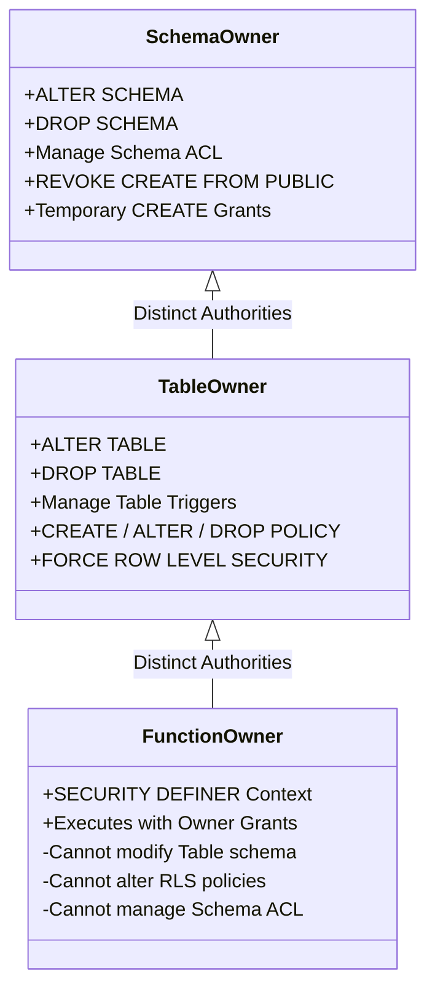

# Fix 3: PostgreSQL SECURITY DEFINER Hardening

## Technical Learning Notes

These notes teach the core PostgreSQL security, privilege, concurrency, and connection-handling concepts implemented in Fix 3, using Fluxora's production codebase as the primary case study.

**Related Documentation**:
- Implementation Report: [`learning/implementations/production-hardening/fix-03-security-definer-hardening.md`](../implementations/production-hardening/fix-03-security-definer-hardening.md)
- Interview Preparation Cheat Sheet: [`learning/interviews/Fix 3 PostgreSQL SECURITY DEFINER Hardening Interview CheatSheet.md`](../interviews/Fix%203%20PostgreSQL%20SECURITY%20DEFINER%20Hardening%20Interview%20CheatSheet.md)
- Migration 0025 Source: [`packages/db/migrations/0025_security_definer_hardening.sql`](../../packages/db/migrations/0025_security_definer_hardening.sql)
- Regression Test Suite: [`packages/db/src/migrate/security-definer-hardening.test.ts`](../../packages/db/src/migrate/security-definer-hardening.test.ts)

---

## 1. PostgreSQL Function Execution Context: `SECURITY INVOKER` vs. `SECURITY DEFINER`

In PostgreSQL, every user-defined function executes under one of two security modes:

```
+------------------------------------+------------------------------------+
| SECURITY INVOKER (Default)         | SECURITY DEFINER                   |
+------------------------------------+------------------------------------+
| Executes with the privileges of the| Executes with the privileges of the|
| current caller (session identity). | role that OWNS the function.       |
|                                    |                                    |
| Caller must possess direct table   | Caller only needs EXECUTE on the   |
| grants (SELECT, UPDATE, etc.).     | function; owner needs table grants.|
|                                    |                                    |
| Safe against privilege escalation; | Powerful, but introduces severe    |
| incapable of privilege elevation.  | privilege escalation risks.        |
+------------------------------------+------------------------------------+
```

### Why Use `SECURITY DEFINER`?
In modern backend architectures, we often need untrusted or low-privilege clients (e.g. an API server handling unauthenticated OAuth callbacks) to perform a sensitive database action without granting that client broad table permissions.
- **Example:** Inserting an OAuth state verifier. If `fluxora_app` held `INSERT` and `DELETE` on `oauth_login_states`, an application vulnerability could allow a compromised API worker to wipe or modify all OAuth states in the database.
- **The Solution:** Revoke direct table grants from `fluxora_app`. Author a `SECURITY DEFINER` function owned by a dedicated role (`fluxora_auth`), granting `EXECUTE` on the function to `fluxora_app`. The application can only interact with the table through the strictly validated function interface.

---

## 2. The Search-Path Hijacking Vulnerability (CVE-2018-1058)

The most infamous vulnerability associated with PostgreSQL `SECURITY DEFINER` functions is **search-path shadowing**.

### 2.1 How PostgreSQL Resolves Object Names
When SQL text references an unqualified object (such as `SELECT * FROM refresh_sessions` or calling `now()`), PostgreSQL searches schemas in the exact order listed in the session's `search_path` parameter:

```sql
SHOW search_path;
-- "$user", public
```

### 2.2 The Temporary Schema Trap (`pg_temp`)
Every PostgreSQL session has a private temporary schema called `pg_temp_nn` (aliased as `pg_temp`), used for temporary tables (`CREATE TEMP TABLE ...`).

PostgreSQL's resolution rules state:
> If `pg_temp` is **not** explicitly listed in `search_path`, PostgreSQL searches `pg_temp` **first** for relation lookups (tables, views).

### 2.3 The Shadowing Exploit Scenario
Consider an unhardened `SECURITY DEFINER` function owned by superuser:
```sql
-- VULNERABLE FUNCTION
CREATE OR REPLACE FUNCTION public.fluxora_consume_oauth_login_state(p_state_hash text)
RETURNS text LANGUAGE plpgsql SECURITY DEFINER AS $$
DECLARE v_verifier text;
BEGIN
  -- Unqualified table name! search_path is not pinned!
  DELETE FROM oauth_login_states WHERE state_hash = p_state_hash
  RETURNING code_verifier INTO v_verifier;
  RETURN v_verifier;
END;
$$;
```

**The Attack:**
1. A malicious or compromised tenant connection creates a temporary table:
   ```sql
   CREATE TEMP TABLE oauth_login_states (
     state_hash text,
     code_verifier text
   );
   ```
2. The attacker inserts a malicious payload or watches the temporary table.
3. When `fluxora_consume_oauth_login_state` is invoked, PostgreSQL checks `pg_temp` first! The `DELETE` targets the attacker's temporary table, breaking application logic or leaking data.
4. Worse, if the function uses custom operators (e.g. `WHERE a = b`), an attacker can create a custom operator in a schema earlier in `search_path` that triggers arbitrary PL/pgSQL code under the function owner's superuser privileges!

### 2.4 The Complete Defense: The Pinned 3-Schema Path
To neutralize CVE-2018-1058, every sensitive function in Fluxora specifies:

```sql
CREATE OR REPLACE FUNCTION public.fluxora_consume_oauth_login_state(p_state_hash text)
RETURNS text LANGUAGE plpgsql
SECURITY DEFINER
SET search_path = pg_catalog, public, pg_temp
AS $$
BEGIN
  -- 1. All relations explicitly schema-qualified
  DELETE FROM public.oauth_login_states
  WHERE state_hash = p_state_hash
  RETURNING code_verifier INTO v_verifier;
  RETURN v_verifier;
END;
$$;
```

**Why this combination is bulletproof:**
1. `pg_catalog` is first: Guarantees built-in system functions (`now()`, `coalesce()`) and operators (`=`, `+`) resolve directly to PostgreSQL internal routines, immune to user shadow functions.
2. `public` is second: Resolves production application tables.
3. `pg_temp` is explicitly last: Placing `pg_temp` after `public` instructs the parser to search `public` *before* `pg_temp`, preventing temporary tables from shadowing persistent tables.
4. Fully schema-qualified references (`public.oauth_login_states`): Bypasses search path resolution entirely for tables and views.
5. Revoking schema creation:
   ```sql
   REVOKE CREATE ON SCHEMA public FROM PUBLIC;
   ```
   Prevents unprivileged users from creating rogue functions or operators in `public`.

---

## 3. PostgreSQL Role Governance: The 7 Security Attributes

PostgreSQL roles are cluster-wide identities governed by 7 critical boolean attributes stored in `pg_catalog.pg_roles`:

```sql
SELECT
  rolname, rolcanlogin, rolsuper, rolcreaterole,
  rolcreatedb, rolbypassrls, rolinherit, rolreplication
FROM pg_catalog.pg_roles;
```

| Attribute | SQL Flag | What It Authorizes | Hardening Requirement for Service Roles |
|---|---|---|---|
| `rolcanlogin` | `NOLOGIN` | Role can initiate a client connection. | **Must be `NOLOGIN`**. Service roles must only be assumed via `SECURITY DEFINER` or `SET ROLE`, never direct login. |
| `rolsuper` | `NOSUPERUSER` | Bypasses all permission checks and RLS. | **Must be `NOSUPERUSER`**. Superusers break least-privilege guarantees. |
| `rolcreaterole`| `NOCREATEROLE` | Can create, alter, or drop other roles. | **Must be `NOCREATEROLE`**. Prevents privilege escalation via role creation. |
| `rolcreatedb` | `NOCREATEDB` | Can create or drop databases. | **Must be `NOCREATEDB`**. Service roles should not manage databases. |
| `rolbypassrls`| `NOBYPASSRLS` | Bypasses Row-Level Security policies. | **Must be `NOBYPASSRLS`**. Prevents accidental cross-tenant data exfiltration. |
| `rolinherit` | `NOINHERIT` | Automatically inherits member privileges.| **Must be `NOINHERIT`**. Prevents unintended privilege creep across memberships. |
| `rolreplication`| `NOREPLICATION`| Can initiate streaming replication. | **Must be `NOREPLICATION`**. |

In Fluxora Migration 0025, an inline defensive block validates that `fluxora_auth` and `fluxora_tenant_guard` satisfy all 7 constraints:

```sql
IF v_can_login OR v_is_superuser OR v_can_create_role OR v_can_create_db
   OR v_bypasses_rls OR v_inherit OR v_replication THEN
  RAISE EXCEPTION 'Existing service role has unsafe attributes; expected NOLOGIN and no elevated privileges';
END IF;
```

---

## 4. PostgreSQL 16+ Role Membership: `ADMIN`, `INHERIT`, and `SET`

PostgreSQL 16 revolutionized role administration. Prior to PG 16, granting a role gave broad, coupled permissions. In PG 16+, membership is split into three orthogonal controls stored in `pg_catalog.pg_auth_members`:

```sql
GRANT service_role TO member_role WITH ADMIN FALSE, INHERIT FALSE, SET TRUE;
```

```
+-----------------------------------------------------------------------------------+
|                        POSTGRESQL 16+ MEMBERSHIP OPTION TAXONOMY                  |
+-------------------+-----------------------------------+---------------------------+
| Option            | What It Enables                   | Risk Profile              |
+-------------------+-----------------------------------+---------------------------+
| `ADMIN TRUE`      | Authorizes member to grant/revoke | CRITICAL PRIVILEGE RISK:  |
|                   | the role to/from any other user.  | Can escalate arbitrary    |
|                   |                                   | users to hold the role.   |
+-------------------+-----------------------------------+---------------------------+
| `INHERIT TRUE`    | Member automatically possesses all| MODERATE CREEP RISK:      |
|                   | privileges of the role without    | Ambient privileges apply  |
|                   | executing `SET ROLE`.             | to every standard query.  |
+-------------------+-----------------------------------+---------------------------+
| `SET TRUE`        | Member can execute `SET ROLE`     | LEAST PRIVILEGE:          |
|                   | to explicitly assume the role     | Privileges only apply when|
|                   | during specific operations.       | explicitly elevated.      |
+-------------------+-----------------------------------+---------------------------+
```

### The `CREATEROLE` Trap in PostgreSQL 16+
A crucial architectural lesson from Fix 3:
> In PostgreSQL 16+, when a non-superuser with `CREATEROLE` creates a new role, PostgreSQL **automatically grants the creator `ADMIN OPTION`** on the created role with `INHERIT FALSE, SET FALSE`.
> Crucially, **a non-superuser cannot revoke `ADMIN OPTION` from itself**!

**The Security Consequence:**
If a non-superuser migration runner executes `CREATE ROLE fluxora_auth`, the migration runner permanently retains administrative power over `fluxora_auth`, able to grant it to anyone.
**The Solution:**
Service roles must be pre-provisioned by a cluster administrator (superuser). The migration runner is granted only temporary membership with `WITH SET TRUE, INHERIT FALSE, ADMIN FALSE` solely to transfer function ownership, which is revoked post-migration.

---

## 5. Schema Ownership vs. Table Ownership vs. Function Ownership

Understanding the division of ownership in PostgreSQL is essential for least-privilege engineering:



### Key Differences:
1. **Schema Ownership (`schema public`)**:
   - Required to execute `REVOKE CREATE ON SCHEMA public FROM PUBLIC;` because ordinary users (even with `GRANT OPTION`) cannot revoke default system grants.
   - Required to issue temporary `CREATE` grants to service roles during function ownership transfers.
   - Requires temporary database-level `CREATE` privilege during `ALTER SCHEMA public OWNER TO ...`, which must be revoked immediately after transfer.
2. **Table Ownership (`relowner`)**:
   - Governs `CREATE POLICY` and `ALTER TABLE ... FORCE ROW LEVEL SECURITY`.
   - Held by the migration runner (`fluxora_migrator`) because it created the tables.
3. **Function Ownership (`proowner`)**:
   - Governs what privileges execute during a `SECURITY DEFINER` call.
   - By transferring function ownership to `fluxora_auth` and `fluxora_tenant_guard` while keeping table ownership with `fluxora_migrator`, service roles cannot tamper with table definitions, disable RLS, or grant table access to other users.

---

## 6. PostgreSQL Advisory Locks: Database-Local, Not Cluster-Global

PostgreSQL provides application-level advisory locks via `pg_advisory_lock(bigint)`.

### The Locality Trap
Many engineers assume advisory locks apply across the entire PostgreSQL instance.
**They do not.**
> **PostgreSQL Documentation:** Advisory locks are allocated per-database. An advisory lock acquired on database `A` has **zero effect** on a connection attached to database `B`, even if both databases run on the exact same PostgreSQL cluster!

```
+-----------------------------------------------------------------------------------+
|                        ADVISORY LOCK LOCALITY IN ACTION                           |
|                                                                                   |
|  [PostgreSQL Server Instance (localhost:5432)]                                   |
|  ├── Database: fluxora_test_worker1                                              |
|  │     Connection 1: SELECT pg_advisory_lock(12345); ---> Lock ACQUIRED!          |
|  │                                                                                |
|  └── Database: fluxora_test_worker2                                              |
|        Connection 2: SELECT pg_try_advisory_lock(12345); ---> Lock ACQUIRED!     |
|                                                                                   |
|  Result: Both connections modify shared cluster roles concurrently! (RACE!)       |
+-----------------------------------------------------------------------------------+
```

### The Fix 3 Concurrency Solution: The Canonical Lock Database
To serialize operations on shared cluster resources (such as `CREATE ROLE` or `pg_auth_members` modifications), all test processes must acquire the advisory lock in a **single shared canonical database**:
1. All workers configure `FLUXORA_CLUSTER_LOCK_DATABASE_URL` pointing to the maintenance database (`postgres`).
2. Each worker connects a dedicated `lockClient` to `postgres` and acquires the session lock:
   ```sql
   SELECT pg_advisory_lock(748920173849102837);
   ```
3. Workers perform their destructive tests in isolated, disposable databases (`fluxora_secdef_upg_<uuid>`).
4. Even if workers run on separate databases, they are strictly serialized by the lock in `postgres`.
5. The lock is released in an unconditional outer `finally` block or automatically upon TCP socket termination.

---

## 7. PostgreSQL Driver Connection String Parsing Divergences

A critical vulnerability discovered in Fix 3C was the discrepancy between Node's standard `new URL()` parser and `node-postgres`'s internal connection parser (`pg-connection-string`).

### 7.1 The Percent-Decoding Bypass
- An attacker or misconfigured test sets: `postgresql://localhost:5432/fluxora%5Fdev`.
- A naive safety validator checks:
  ```ts
  const parsed = new URL(urlString);
  if (parsed.pathname === "/fluxora_dev") throw new Error("Blocked!"); // DOES NOT THROW!
  ```
  `parsed.pathname` evaluates to `"/fluxora%5Fdev"`.
- But when passed to `new pg.Client(urlString)`, `pg-connection-string` decodes `%5F` to `_`, connecting directly to `fluxora_dev` and executing destructive queries against the developer database!

### 7.2 The Query Parameter Override Bypass
The PostgreSQL driver allows query parameters to override the URL authority:
```text
postgresql://localhost:5432/disposable_db?host=remote.evil.com&port=9999&dbname=fluxora_dev
```
- `new URL().hostname` returns `localhost`.
- `new URL().pathname` returns `/disposable_db`.
- But `pg.Client` parses the query parameters and connects to `remote.evil.com:9999/fluxora_dev`!

### 7.3 The Fix 3C Defensive Parsing Pipeline
To prevent this, Fluxora implements a strict multi-stage parsing pipeline in `validatePostgresConnectionString`:
1. **Driver-Level Parsing**: Uses `parsePgConnectionString` resolved directly from the installed `pg` dependency via `createRequire`.
2. **Regex Validation**:
   - Rejects malformed percent-encoding with `/%(?![0-9a-fA-F]{2})/i`.
   - Enforces digits-only port formatting with `/^\d+$/`, rejecting negative numbers, decimals, hex, and trailing text (`5432junk`).
   - Normalizes omitted port to `5432` only when genuinely absent from both URL and query parameters.
3. **Decoded Database Evaluation**: Decodes the effective database name (from `dbname`, `database`, or path) and rejects `fluxora_dev` or `*_dev`.
4. **Branded Configuration Objects**:
   Returns a frozen `ValidatedPostgresConfig` containing an explicit `clientConfig` object (`host`, `port`, `database`, `user`, `password`, `ssl`).
   Secondary clients derive configurations using pure helper `deriveClientConfig()`.
   **No client in the test suite is ever constructed using a raw connection string.**

---

## 8. Summary Checklist for PostgreSQL Hardening

When designing production-grade PostgreSQL functions and migrations:
- [x] Pin `search_path = pg_catalog, public, pg_temp` on every `SECURITY DEFINER` function.
- [x] Place `pg_temp` last in `search_path` and fully schema-qualify all relation references (`public.<table>`).
- [x] Revoke `CREATE ON SCHEMA public FROM PUBLIC;`.
- [x] Revoke `EXECUTE` on functions from `PUBLIC`, granting strictly to authorized runtime roles.
- [x] Assign function ownership to dedicated `NOLOGIN` service roles, not superusers or migration runners.
- [x] Pre-provision service roles via trusted administrator to prevent PostgreSQL 16+ `CREATEROLE` `ADMIN OPTION` escalation.
- [x] Use a shared canonical database for advisory locks when serializing cluster-level role operations.
- [x] Parse and validate effective driver connection properties using `pg-connection-string`, never relying solely on native `URL`.

---

## 9. Operational Safety Limitations & Verification Status

> [!IMPORTANT]
> **Status:** Implementation and non-destructive verification completed; live destructive PostgreSQL integration verification pending.

The following configuration variables are not set in the local development environment:
- `FLUXORA_QUEUE_TEST_DATABASE_URL` is not configured locally.
- `QUEUE_TEST_DATABASE_URL` is not configured locally.
- `FLUXORA_CLUSTER_LOCK_DATABASE_URL` is not configured locally.
- `FLUXORA_ALLOW_DESTRUCTIVE_QUEUE_MIGRATION_TESTS=true` is not configured locally.

Consequently, **live integration verification remains pending**. Verification must use a dedicated disposable PostgreSQL test database and a separate canonical advisory-lock database. Both databases must target the same PostgreSQL server, with validated host and port consistency. **`fluxora_dev` must never be used for destructive tests.** No credentials or database URLs are exposed in tests, notes, or execution logs.

The five live integration tests in `packages/db/src/migrate/security-definer-hardening.test.ts` remain unverified locally until executed against a dedicated disposable PostgreSQL test cluster:
1. Live migration 0025 and service-role isolation (`applies migration 0025 without ADMIN OPTION and verifies strict service-role isolation`).
2. Clean migration bootstrap from 0001–0025 (`performs clean installation from 0001 through 0025 using a constrained non-superuser role`).
3. Advisory-lock contention (`serializes a second lock contender with a distinct validated queue database configuration sharing the canonical lock database`).
4. Preservation of pre-existing PostgreSQL role state (`leaves existing cluster runtime and service role passwords and attributes unchanged`).
5. Constrained migration schema privileges (`proves the constrained migration role possesses exact required schema privileges without superuser or BYPASSRLS`).
